 

 

<picture>
  <source media="(prefers-color-scheme: dark)" srcset="assets/h-now-dark.svg" />
  
</picture>

  

<picture>
  <source media="(prefers-color-scheme: dark)" srcset="assets/h-work-dark.svg" />
  
</picture>

  
  

  
  

 

<picture>
  <source media="(prefers-color-scheme: dark)" srcset="assets/h-stack-dark.svg" />
  
</picture>

  <picture>
    <source media="(prefers-color-scheme: dark)" srcset="https://skillicons.dev/icons?i=py,cpp,java,ts,js,r,postgres,bash&theme=dark" />
    
  </picture>
   
  <picture>
    <source media="(prefers-color-scheme: dark)" srcset="https://skillicons.dev/icons?i=pytorch,tensorflow,sklearn,react,nodejs,fastapi,flask&theme=dark" />
    
  </picture>
   
  <picture>
    <source media="(prefers-color-scheme: dark)" srcset="https://skillicons.dev/icons?i=docker,aws,azure,gcp,vercel,git,linux&theme=dark" />
    
  </picture>
   
  plus&nbsp; Pandas · NumPy · Plotly · Matplotlib · Streamlit · Power BI · Tableau

 

<picture>
  <source media="(prefers-color-scheme: dark)" srcset="assets/h-focus-dark.svg" />
  
</picture>

  

<picture>
  <source media="(prefers-color-scheme: dark)" srcset="assets/h-contact-dark.svg" />
  
</picture>

  Open to <b>software engineering</b>, <b>quant</b> and <b>data</b> internships, and to building with founders who need systems that actually ship. 
  Reach me on <a href="https://www.linkedin.com/in/eli-k-7496632a3">LinkedIn</a>.

